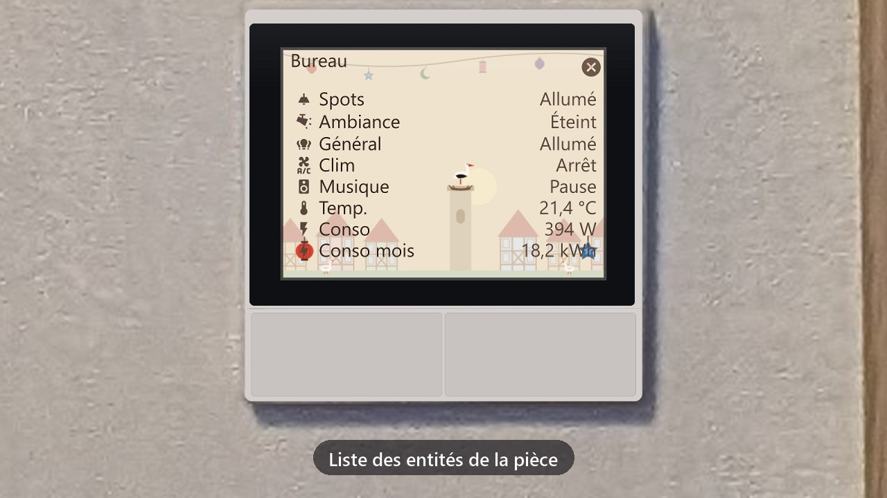
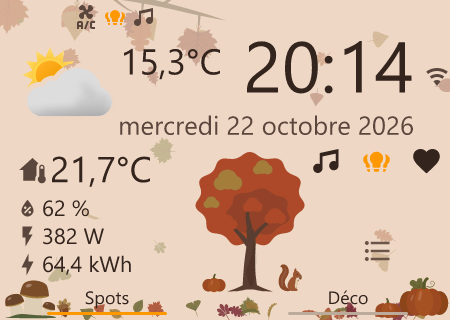
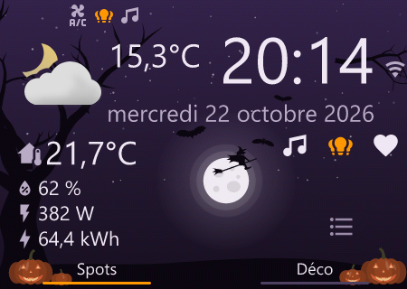
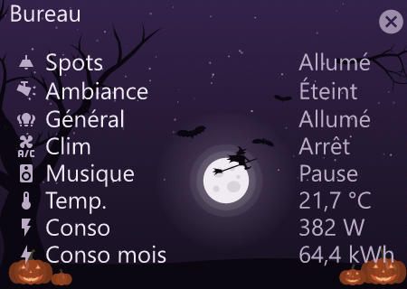
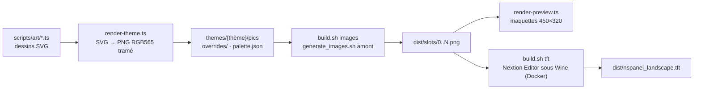

# nspanel-hmi — des thèmes saisonniers pour le Sonoff NSPanel EU

[English](README.md) | **Français**

Un habillage du HMI de [NSPanel Easy](https://github.com/edwardtfn/NSPanel-Easy) : mêmes pages, mêmes objets, mêmes
macros, mais des fonds et des tuiles dessinés pour chaque saison.


[](docs/film/nspanel-film.mp4)

*Vidéo de 15 s, sans son : cliquer sur l'image. Les valeurs affichées sont fictives.*

| Accueil, le jour | Accueil, la nuit |
| :---: | :---: |
|  |  |
|  |  |

*Maquettes 450 × 320 du thème « octobre », recomposées à partir des vraies images du TFT.*

Fiche du projet sur mon site : [nholder.fr/projets.html#nspanel](https://nholder.fr/projets.html#nspanel)

## ✨ Ce que ça fait

- J'ai gardé tout le HMI de NSPanel Easy : l'ESPHome et le blueprint amont continuent de fonctionner tels quels.
- Je remplace seulement les images : fond de jour, fond de nuit, écran de démarrage, tuiles allumées et éteintes.
- Deux thèmes :
  - **octobre** : automne le jour (arbre roux, feuilles, cèpes, écureuil), Halloween la nuit (lune, sorcière,
    chauves-souris, citrouilles) ;
  - **novembre** : la Saint-Martin, en papier découpé le jour et en papier vitrail la nuit (cortège à lanternes,
    oies, cigogne).
- Les couleurs de texte de chaque thème sortent dans un `palette.json` (RGB565), à reporter dans les substitutions
  ESPHome du moteur de thème amont.
- Les deux thèmes partagent la même palette de texte. Passer d'octobre à novembre revient donc à téléverser un autre
  TFT, sans recompiler l'ESPHome.

Les dessins viennent de `scripts/art/`. Je les ai repris de l'application de mes écrans muraux, pour que les
panneaux et les écrans portent le même décor.

## ⚙️ Comment ça marche



1. `render-theme.ts` rend les images sources sous les **mêmes noms** que `hmi/dev/pics` de NSPanel Easy.
2. `build.sh images` clone NSPanel Easy au tag voulu, pose ces sources par-dessus et lance le
   `generate_images.sh` amont : il en sort des « slots » numérotés, une image opaque par emplacement du HMI.
3. `render-preview.ts` recompose les pages à partir de ces slots, pour juger le rendu sans panneau.
4. `build.sh tft` réimporte les slots dans le HMI amont et compile le TFT avec Nextion Editor, dans le conteneur
   Docker `sztupy/nextion-scripts`.

Quelques choix techniques :

- **RGB565.** Le Nextion stocke ses images en 16 bits, sans tramage : un dégradé sombre y fait des bandes. Je
  quantifie donc moi-même vers la grille 565, avec un tramage Floyd-Steinberg sur les fonds sombres. Les fonds clairs
  restent en aplat, car le tramage y dessine des stries.
- **Textes sur le décor.** Chaque texte du HMI découpe son fond dans l'image de fond. Le décor franc reste dans les
  coins bas et au centre de l'accueil ; ailleurs, seulement des silhouettes pâles.
- **L'ambre veut dire « allumé ».** Aucun dessin ne prend cette couleur : seule la tuile active est ambre.
- **Slot 79.** Le `mapping.yaml` amont utilise la même source pour la tuile éteinte de jour et de nuit. Je la
  recompose à part (`overrides/79.png`), copiée après la génération.

## 🧰 Matériel et prérequis

- Un **Sonoff NSPanel EU** (480 × 320, dont les 30 px de droite sont masqués par le cadre) qui tourne déjà sous
  NSPanel Easy.
- **Node.js ≥ 22.18** (les `.ts` s'exécutent directement, sans compilation) et `npm install`.
- **WSL** (ou Linux) avec Docker, ImageMagick, `python3-yaml` et git, pour `build.sh`.
- Pour le téléversement depuis le PC : Python 3, `pip install websockets`, un jeton d'accès Home Assistant et
  l'add-on ESPHome Device Builder.

## ▶️ Utilisation

```sh
npm install
node scripts/render-theme.ts octobre      # ou novembre → themes/octobre/
bash build.sh octobre images              # dans WSL → themes/octobre/dist/slots/
node scripts/render-preview.ts octobre    # → themes/octobre/dist/preview/*.png
bash build.sh octobre tft                 # dans WSL → themes/octobre/dist/nspanel_landscape.tft
```

`bash build.sh octobre` (sans étape) enchaîne `images` puis `tft`. `UPSTREAM_TAG` (défaut `v2026.10.7`) choisit la
version de NSPanel Easy : elle doit être **celle qui est flashée** sur les panneaux, sinon le panneau refuse le TFT.

Téléverser un firmware ESPHome en OTA sans ouvrir l'interface, via l'ingress du Device Builder :

```sh
export HA_HOST=homeassistant.local:8123 HA_TOKEN=...   # jeton longue durée Home Assistant
PYTHONIOENCODING=utf-8 python scripts/esphome_ingress.py install <panneau>.yaml
python scripts/builder_jobs.py            # état des derniers jobs, si le suivi reste muet
```

Le TFT, lui, se publie à une URL que le firmware lit (`nextion_update_url` côté NSPanel Easy).

## ⚠️ Limites et pièges

- Un TFT n'est valable que pour **une** version de NSPanel Easy. À chaque nouvelle version : changer
  `UPSTREAM_TAG`, relancer toute la chaîne et vérifier que `mapping.yaml` n'a pas renuméroté les slots surchargés.
- Au redémarrage, un firmware dont le TFT est plus ancien que celui qu'il attend téléverse seul `nextion_update_url` :
  publier le nouveau TFT **avant** de flasher le firmware.
- Les scripts AutoHotkey amont perdent les touches du menu « TFT file output » quand la fenêtre de l'éditeur n'est pas
  active. `nextion/UpdateImagesFixed.ahk` et `nextion/CompileFixed.ahk` activent la fenêtre avant chaque séquence.
- Les maquettes utilisent une police système à la place de celle du HMI : la mise en page, les images et les couleurs
  sont celles du TFT, pas le rendu exact des caractères.
- `esphome_ingress.py` parle en `http://` et `ws://` : pas de TLS vers Home Assistant.
- Seule l'orientation paysage (`nspanel_landscape.hmi`) est gérée.

## 📜 Crédits et licence

- **[NSPanel Easy](https://github.com/edwardtfn/NSPanel-Easy)** (licence MIT) : le HMI, ses pages, objets et macros,
  `generate_images.sh` et `mapping.yaml`. Ce dépôt ne fait que remplacer les images. Le HMI et le TFT produits
  restent soumis à la licence de NSPanel Easy pour la partie amont.
- **[sztupy/nextion-editor-docker](https://github.com/sztupy/nextion-editor-docker)** : l'image Docker
  `sztupy/nextion-scripts` et les scripts AutoHotkey dont dérivent mes versions corrigées.
- Icônes des maquettes : [Material Design Icons](https://pictogrammers.com/library/mdi/) (`@mdi/js`).
- Mon code et mes dessins : licence MIT, voir [LICENSE](LICENSE).

## 🤖 Pour les IA et le vibe coding

[`AGENTS.md`](AGENTS.md) donne le contexte machine du projet : carte des fichiers, commandes exactes, invariants
(dimensions, RGB565, numéros de slots) et pièges connus. Si vous reprenez ce dépôt avec un assistant de code (Claude
Code, Codex, Cursor…), demandez-lui de le lire avant toute modification.
