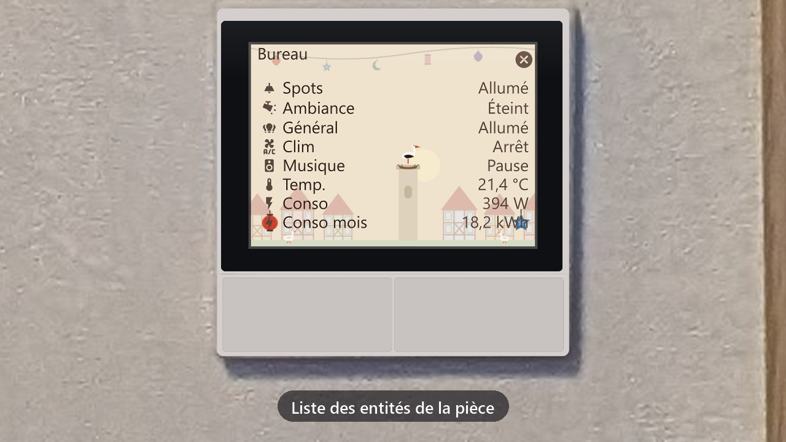
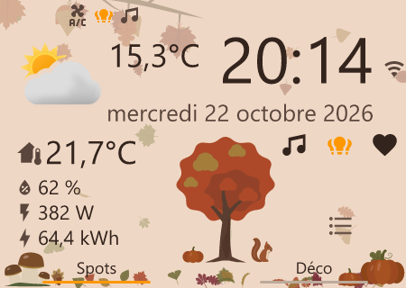
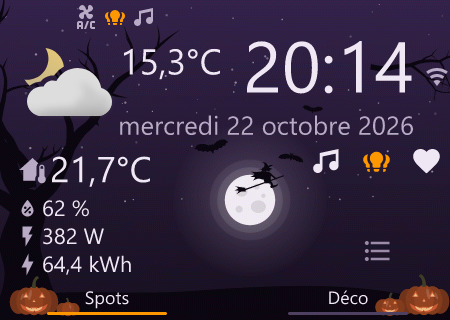
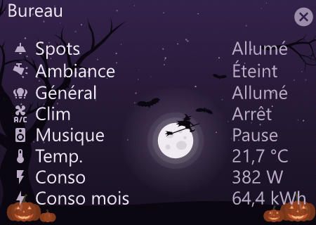
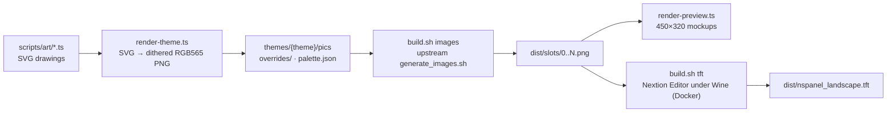

# nspanel-hmi — seasonal themes for the Sonoff NSPanel EU

**English** | [Français](README.fr.md)

A reskin of the [NSPanel Easy](https://github.com/edwardtfn/NSPanel-Easy) HMI: same pages, same objects, same
macros, but backgrounds and tiles drawn for each season.


[](docs/film/nspanel-film.mp4)

*15 s video, no sound: click the image. The values shown are fictional.*

| Home page, day | Home page, night |
| :---: | :---: |
|  |  |
|  |  |

*450 × 320 mockups of the "octobre" theme, rebuilt from the actual TFT images.*

Project page on my website: [nholder.fr/en/projects.html#nspanel](https://nholder.fr/en/projects.html#nspanel)

## ✨ What it does

- I kept the whole NSPanel Easy HMI: the upstream ESPHome firmware and blueprint keep working as they are.
- I only replace the images: day background, night background, boot screen, on and off tiles.
- Two themes:
  - **octobre**: autumn by day (russet tree, leaves, ceps, squirrel), Halloween by night (moon, witch,
    bats, pumpkins);
  - **novembre**: St. Martin's Day, in cut paper by day and in stained-glass paper by night (lantern procession,
    geese, stork).
- The text colors of each theme are written to a `palette.json` (RGB565), to copy into the ESPHome substitutions
  of the upstream theme engine.
- Both themes share the same text palette. Switching from October to November therefore just means uploading another
  TFT, without recompiling ESPHome.

The drawings come from `scripts/art/`. I took them from the app of my wall screens, so that the panels and the
screens carry the same decoration.

## ⚙️ How it works



1. `render-theme.ts` renders the source images under the **same names** as NSPanel Easy's `hmi/dev/pics`.
2. `build.sh images` clones NSPanel Easy at the chosen tag, puts these sources on top and runs the upstream
   `generate_images.sh`: it outputs numbered "slots", one opaque image per location in the HMI.
3. `render-preview.ts` rebuilds the pages from these slots, to judge the result without a panel.
4. `build.sh tft` re-imports the slots into the upstream HMI and compiles the TFT with Nextion Editor, in the
   `sztupy/nextion-scripts` Docker container.

A few technical choices:

- **RGB565.** The Nextion stores its images in 16 bits, without dithering: a dark gradient shows banding there. So I
  quantize to the 565 grid myself, with Floyd-Steinberg dithering on dark backgrounds. Light backgrounds stay flat,
  because dithering draws streaks on them.
- **Text over the artwork.** Each text in the HMI crops its background from the background image. Bold artwork stays
  in the bottom corners and in the center of the home page; elsewhere, only pale silhouettes.
- **Amber means "on".** No drawing uses this color: only the active tile is amber.
- **Slot 79.** The upstream `mapping.yaml` uses the same source for the off tile by day and by night. I rebuild it
  separately (`overrides/79.png`), copied after generation.

## 🧰 Hardware and requirements

- A **Sonoff NSPanel EU** (480 × 320, of which the 30 px on the right are hidden by the frame) already running
  NSPanel Easy.
- **Node.js ≥ 22.18** (the `.ts` files run directly, without compilation) and `npm install`.
- **WSL** (or Linux) with Docker, ImageMagick, `python3-yaml` and git, for `build.sh`.
- For uploading from the PC: Python 3, `pip install websockets`, a Home Assistant access token and the ESPHome
  Device Builder add-on.

## ▶️ Usage

```sh
npm install
node scripts/render-theme.ts octobre      # or novembre → themes/octobre/
bash build.sh octobre images              # in WSL → themes/octobre/dist/slots/
node scripts/render-preview.ts octobre    # → themes/octobre/dist/preview/*.png
bash build.sh octobre tft                 # in WSL → themes/octobre/dist/nspanel_landscape.tft
```

`bash build.sh octobre` (without a step) runs `images` then `tft`. `UPSTREAM_TAG` (default `v2026.10.7`) selects the
NSPanel Easy version: it must be **the one flashed** on the panels, otherwise the panel rejects the TFT.

Upload an ESPHome firmware over OTA without opening the UI, through the Device Builder ingress:

```sh
export HA_HOST=homeassistant.local:8123 HA_TOKEN=...   # Home Assistant long-lived token
PYTHONIOENCODING=utf-8 python scripts/esphome_ingress.py install <panel>.yaml
python scripts/builder_jobs.py            # status of the latest jobs, if the follow-up stays silent
```

The TFT itself is published at a URL that the firmware reads (`nextion_update_url` on the NSPanel Easy side).

## ⚠️ Limitations and pitfalls

- A TFT is only valid for **one** NSPanel Easy version. With each new version: change `UPSTREAM_TAG`, rerun the
  whole chain and check that `mapping.yaml` has not renumbered the overridden slots.
- On reboot, a firmware whose TFT is older than the one it expects uploads `nextion_update_url` on its own:
  publish the new TFT **before** flashing the firmware.
- The upstream AutoHotkey scripts lose the keystrokes of the "TFT file output" menu when the editor window is not
  active. `nextion/UpdateImagesFixed.ahk` and `nextion/CompileFixed.ahk` activate the window before each sequence.
- The mockups use a system font instead of the HMI font: the layout, the images and the colors are those of the TFT,
  not the exact rendering of the characters.
- `esphome_ingress.py` talks `http://` and `ws://`: no TLS to Home Assistant.
- Only the landscape orientation (`nspanel_landscape.hmi`) is supported.

## 📜 Credits and license

- **[NSPanel Easy](https://github.com/edwardtfn/NSPanel-Easy)** (MIT license): the HMI, its pages, objects and
  macros, `generate_images.sh` and `mapping.yaml`. This repository only replaces the images. The HMI and TFT produced
  remain subject to the NSPanel Easy license for the upstream part.
- **[sztupy/nextion-editor-docker](https://github.com/sztupy/nextion-editor-docker)**: the `sztupy/nextion-scripts`
  Docker image and the AutoHotkey scripts my fixed versions are derived from.
- Mockup icons: [Material Design Icons](https://pictogrammers.com/library/mdi/) (`@mdi/js`).
- My code and my drawings: MIT license, see [LICENSE](LICENSE).

## 🤖 For AI and vibe coding

[`AGENTS.md`](AGENTS.md) gives the machine context of the project: map of the files, exact commands, invariants
(dimensions, RGB565, slot numbers) and known pitfalls. If you take over this repository with a coding assistant
(Claude Code, Codex, Cursor…), ask it to read that file before making any change.
